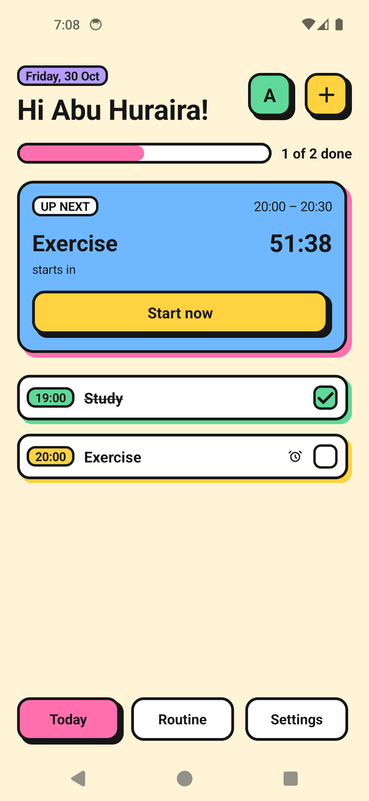
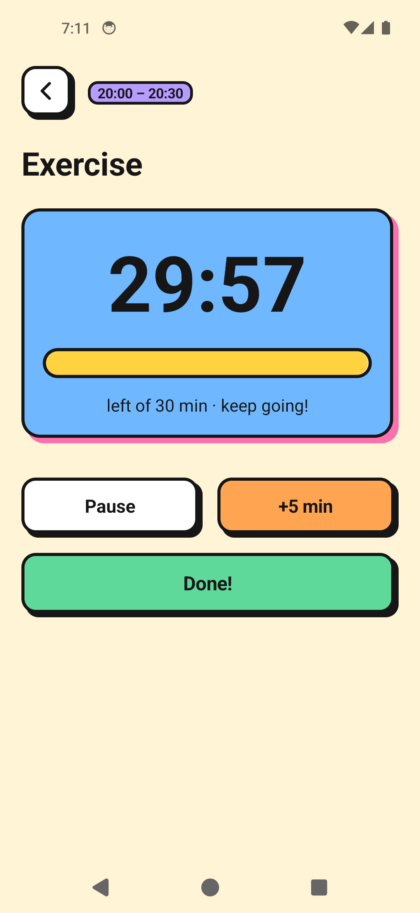
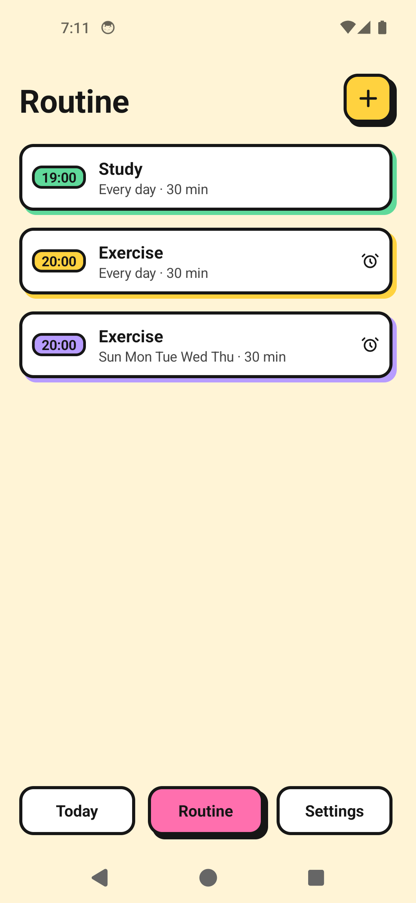
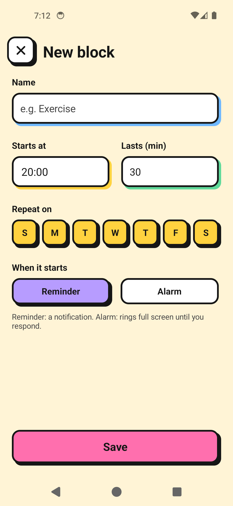
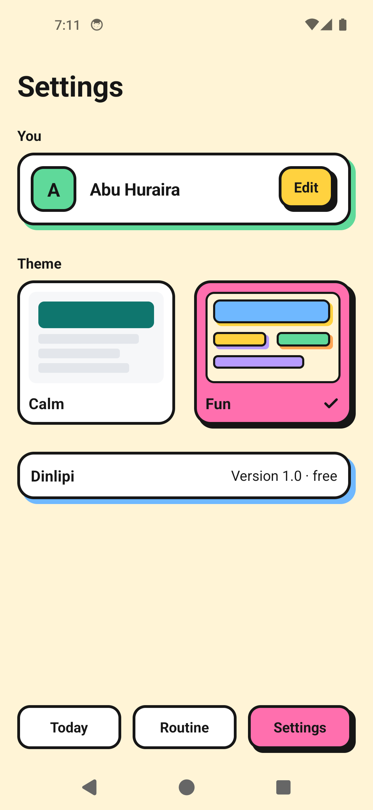

# Dinlipi

A free, personal daily routine app for Android. Plan your day as time blocks, get a reminder or a
full-screen alarm when each one starts, and run a timer while you do it.

Built for students, job holders and anyone aged 17–45 who wants a simple daily routine, and made to
run well on old and low-end phones.

<p>
  
  
  
  
  
</p>

## What it does

| Feature | Details |
| --- | --- |
| **Routine blocks** | Name, start time, length and which days it repeats. |
| **Reminder or alarm** | A reminder is a notification. An alarm rings full screen, even on the lock screen, until you start, snooze (5 min) or skip. |
| **Block timer** | Countdown with Pause, +5 min and Done. Notifies you when time is up, even if the app is closed. |
| **Today view** | What's on now or next with a live countdown, your progress, and a tick list for the day. |
| **One suggestion** | Started a block 10+ minutes late? Dinlipi offers to move the rest of your day later. |
| **Two themes** | *Calm* (clean and quiet) and *Fun* (boxy, colourful, bold borders and coloured shadows). |

There are deliberately few options. New ones get added only when they're asked for.

## Built to be light

- **About 70 KB APK.** Plain Kotlin and the Android framework only. No AndroidX, no Firebase, no
  third-party libraries.
- **Android 5.0 (API 21) and up.**
- **No internet and no accounts.** Data stays on the phone in one small SQLite file.
- **No background service.** Alarms are scheduled with `AlarmManager` and survive reboots.
- The UI is drawn in code with simple shapes: no images, custom fonts or animations.

## Install

Download the APK, open it on your phone, and allow **Install unknown apps** when Android asks.
After installing:

1. Allow notifications. Without them reminders and alarms can't ring, and the app shows a
   warning card until they're on.
2. On Xiaomi, Oppo, Vivo, Realme and similar phones, set the app's battery usage to
   **No restrictions** so alarms aren't delayed.

## Build

You need JDK 17 and the Android SDK (platform 35).

```sh
./gradlew assembleRelease   # app/build/outputs/apk/release/app-release.apk
./gradlew assembleDebug     # app/build/outputs/apk/debug/app-debug.apk
```

Or open the folder in Android Studio and press **Run**.

The release build is shrunk with R8 and, for now, signed with the debug key so it can be installed
for testing. Before publishing to Play Store, create your own keystore and set it in
`app/build.gradle.kts`.

## Code map

| File | What it does |
| --- | --- |
| `MainActivity.kt` | Today, Routine and Settings tabs |
| `OnboardingActivity.kt` | First launch: asks for your name |
| `EditBlockActivity.kt` | Add, edit or delete a block |
| `TimerActivity.kt` | Countdown with Pause, +5 min and Done |
| `AlarmActivity.kt` | Full-screen alarm: Start now, Snooze 5 min or Skip |
| `Alarms.kt` | Schedules alarms and reminders and shows notifications |
| `Receivers.kt` | Fires alarms and reschedules them after a reboot or time change |
| `Db.kt` | SQLite storage for blocks, daily status and "move later" shifts |
| `Ui.kt` | The Calm and Fun themes and shared UI pieces |
| `Prefs.kt`, `Time.kt` | Small settings and time helpers |

All source files are in `app/src/main/java/com/dinlipi/app/`.

## License

Free for personal use.
